# คู่มือผู้ใช้งานและการดูแลรักษาระบบอย่างสมบูรณ์: PrintOps Station App & Web Control Plane
**(PrintOps Complete Step-by-Step User & Administrator Guide)**

> **เอกสารอ้างอิงรุ่นระบบ (System Version):** PrintOps Station `v0.1.42` | Web Control Plane `v1.0.5`  
> **กลุ่มเป้าหมายผู้ใช้งาน:** เจ้าหน้าที่หน้างาน (Operator), ผู้ดูแลระบบประจำจุดบริการ/แผนก (Admin), และผู้ดูแลระบบส่วนกลาง/วิศวกรระบบเชื่อมต่อ (System Owner / Integrator)

---

## สารบัญ (Table of Contents)

1. **[บทที่ 1: ภาพรวมระบบและสถาปัตยกรรมการทำงาน (System Overview & Architecture)](#part-1)**
   - 1.1 ความแตกต่างและบทบาทของ PrintOps Station App กับ Web Control Plane
   - 1.2 แผนผังการไหลของข้อมูลตั้งแต่ต้นทางถึงเครื่องพิมพ์จริง (End-to-End Print Flow)
   - 1.3 พันธสัญญาด้านความปลอดภัย: การป้องกันพิมพ์ซ้ำ (Zero Duplicate Prints) และการยืนยันผลฮาร์ดแวร์
2. **[บทที่ 2: คู่มือการใช้งานแอปพลิเคชัน PrintOps ประจำจุดบริการ (PrintOps Station App)](#part-2)**
   - 2.1 การเข้าสู่ระบบ การตั้งค่าผู้ดูแลระบบคนแรก (Owner Setup) และการกู้คืนรหัสผ่าน
   - 2.2 การอ่านค่าหน้าแดชบอร์ด (Dashboard) และแถบแจ้งเตือนงานที่ต้องตรวจสอบ (Attention Strip)
   - 2.3 ขั้นตอนที่ 1: การค้นหาและลงทะเบียนเครื่องพิมพ์ในระบบ (Discovery & Printers)
   - 2.4 ขั้นตอนที่ 2: การออกแบบโปรไฟล์กระดาษและจัดวางฟิลด์ฉลาก (Paper Profiles Designer)
   - 2.5 ขั้นตอนที่ 3: การสร้างและเผยแพร่เทมเพลตคำสั่งพิมพ์ (Templates: ZPL / TSPL / HTML / Raw)
   - 2.6 ขั้นตอนที่ 4: การผูกโฟลว์การพิมพ์อัตโนมัติ (Print Flow & Bindings)
   - 2.7 ขั้นตอนที่ 5: การจำลองและทดสอบพิมพ์จริงด้วยแซนด์บ็อกซ์ (Template Sandbox)
   - 2.8 การตรวจสอบคิวงาน (Job Queue) หลักฐานการพิมพ์ (Hardware Evidence) และการสั่งพิมพ์ซ้ำอย่างปลอดภัย
   - 2.9 การตั้งค่าเชื่อมต่อระบบภายนอก (Webhooks, Route Policies, NATS JetStream, Service API Keys)
   - 2.10 การจัดการสิทธิ์ผู้ใช้งาน (Users & Roles), ประวัติตรวจสอบ (Audit Logs) และการสำรองข้อมูล
3. **[บทที่ 3: คู่มือการใช้งานระบบควบคุมส่วนกลาง (Web Control Plane)](#part-3)**
   - 3.1 การเข้าสู่ระบบ Web Control Plane และภาพรวมการบริหารจัดการเครื่องลูกข่าย
   - 3.2 ขั้นตอนการเชื่อมโยงสถานีพิมพ์เข้ากับส่วนกลาง (Station Enrollment Workflow)
   - 3.3 การตรวจสอบสถานะสถานีพิมพ์ในเครือข่าย (Devices Monitoring & Discovery)
   - 3.4 การบริหารจัดการแพ็กเกจตัวติดตั้งและพื้นที่จัดเก็บไฟล์ (Releases Catalog & MinIO/Local Storage)
   - 3.5 การสั่งอัปเดตซอฟต์แวร์ทางไกลและการย้อนกลับเวอร์ชันอัตโนมัติ (Supervised Breakaway OTA & Rollback)
   - 3.6 การกระจายและดึงกลับโปรไฟล์กระดาษและเทมเพลตข้ามสาขา/แผนก (Content Distribution & Pull)
4. **[บทที่ 4: แนวทางการแก้ไขปัญหาเบื้องต้นและคำถามที่พบบ่อย (Troubleshooting & FAQ)](#part-4)**

---

<div id="part-1"></div>

## บทที่ 1: ภาพรวมระบบและสถาปัตยกรรมการทำงาน (System Overview & Architecture)

**PrintOps** คือแพลตฟอร์มเกตเวย์สำหรับจัดการและควบคุมการพิมพ์ระดับองค์กรและสถานพยาบาล (Industrial & Clinical Edge-Print Orchestration Gateway) ที่ทำหน้าที่เป็นตัวกลางเชื่อมต่อระหว่างระบบสารสนเทศหลัก (เช่น HIS, LIS, ERP, WMS) ไปยังเครื่องพิมพ์สติกเกอร์ความร้อน (Thermal Label Printers), เครื่องพิมพ์ใบเสร็จ และเครื่องพิมพ์เอกสารประจำจุดบริการต่างๆ อย่างแม่นยำ

### 1.1 ความแตกต่างและบทบาทของทั้ง 2 ระบบหลัก

เพื่อให้เข้าใจการทำงานได้ง่ายที่สุด ระบบ PrintOps แบ่งออกเป็น **2 ส่วนประกอบหลัก** ที่ทำงานประสานกัน ดังนี้:

| หัวข้อเปรียบเทียบ | 1. PrintOps Station App (แอปประจำจุดพิมพ์) | 2. Web Control Plane (ระบบควบคุมส่วนกลาง) |
| :--- | :--- | :--- |
| **สถานที่ติดตั้ง** | ติดตั้งลงบนเครื่องคอมพิวเตอร์ Windows (Desktop App) หรือมินิพีซีที่ต่อสาย USB / LAN กับเครื่องพิมพ์โดยตรง ณ จุดบริการ (เช่น ห้องยา, จุดเจาะเลือด, เคาน์เตอร์พยาบาล) | ติดตั้งบนเซิร์ฟเวอร์ส่วนกลางขององค์กร (Docker Compose บน Linux Server) เปิดใช้งานผ่านเว็บเบราว์เซอร์ |
| **หน้าที่หลัก** | รับคำสั่งพิมพ์ (ผ่าน HTTP API หรือ NATS), แปลงข้อมูลลงเทมเพลต (ZPL/TSPL/HTML), ส่งงานเข้าเครื่องพิมพ์, ตรวจสอบว่ากระดาษออกมาจริง และแจ้งผลกลับ (Callback) | เฝ้าดูสถานะเครื่องลูกข่าย PrintOps ทุกจุด, สร้างโทเคนลงทะเบียนเครื่องใหม่, กระจายเทมเพลต/โปรไฟล์กระดาษมาตรฐานไปให้ทุกเครื่อง และสั่งอัปเดตเวอร์ชัน (OTA) ทางไกล |
| **ทำงานขณะเน็ตตัดขาดได้หรือไม่?** | **ทำงานต่อได้ทันที (Offline-First)** เพราะมีฐานข้อมูล SQLite และตัวรันงานพิมพ์ (Local Print Worker & Go Runner) อยู่ในตัวเครื่องเอง | ใช้สำหรับบริหารจัดการผ่านเครือข่ายภายใน (LAN/VPN) หากเซิร์ฟเวอร์ส่วนกลางหยุดพัก เครื่องลูกข่ายหน้างานยังพิมพ์งานได้ตามปกติ |

### 1.2 แผนผังสถาปัตยกรรมการทำงาน (Architecture Workflow)

```text
┌─────────────────────────────────────────────────────────────────────────────────────┐
│                   ระบบสารสนเทศต้นทาง (HIS / LIS / ERP / WMS)                        │
└───────────────────┬─────────────────────────────────────────────┬───────────────────┘
                    │ 1. ส่งคำสั่งพิมพ์ (HTTP POST / NATS)          │ 5. แจ้งผลลัพธ์กลับ
                    ▼                                             │    (Webhook / NATS)
┌─────────────────────────────────────────────────────────────────┴───────────────────┐
│ 💻 PrintOps Station App (ติดตั้งที่เครื่องหน้างาน เช่น ห้องจ่ายยา / ห้องแล็บ)              │
│  ┌──────────────────────────┐    ┌─────────────────────────┐    ┌────────────────┐  │
│  │ ตรวจสอบป้องกันงานซ้ำ      │───▶│ จับคู่ Template +       │───▶│ สั่งพิมพ์และตรวจ │  │
│  │ (Idempotency Check)      │    │ Paper Profile + Printer │    │ ยืนยันฮาร์ดแวร์ │  │
│  └──────────────────────────┘    └─────────────────────────┘    └───────┬────────┘  │
└───────────────────────────────────────▲─────────────────────────────────┼───────────┘
                                        │                                 │
          2. ซิงก์เทมเพลต / สั่งอัปเดต OTA │ (ผ่าน NATS JetStream)          │ 3. พิมพ์จริง
                                        ▼                                 ▼
┌─────────────────────────────────────────────────────────┐     ┌─────────────────────┐
│ 🌐 Web Control Plane (เซิร์ฟเวอร์ควบคุมส่วนกลาง)          │     │ 🖨️ เครื่องพิมพ์จริง    │
│  • ลงทะเบียนและตรวจสุขภาพเครื่องลูกข่าย (Devices)          │     │  • Zebra / TSC      │
│  • กระจายโปรไฟล์กระดาษและเทมเพลตมาตรฐาน (Content Sync)  │     │  • Raw TCP :9100    │
│  • คลังแพ็กเกจติดตั้งและอัปเดตทางไกล (OTA Releases)       │     │  • Windows Spooler  │
└─────────────────────────────────────────────────────────┘     └─────────────────────┘
```

### 1.3 ความหมายของสถานะงานพิมพ์และการป้องกันพิมพ์ซ้ำ (Print Verdict & Safety)

หัวใจสำคัญที่สุดของ PrintOps คือ **การไม่พิมพ์ฉลากซ้ำโดยไม่ตั้งใจ (Zero Accidental Duplicate Prints)** ระบบจึงแยกระหว่าง *"ส่งงานเข้าคิวแล้ว"* กับ *"เครื่องพิมพ์พิมพ์กระดาษออกมาจริงแล้ว"* อย่างชัดเจน:

- **`QUEUED` / `DISPATCHED` / `PRINTING` (กำลังดำเนินการ):** งานผ่านการตรวจสอบความถูกต้องและกำลังส่งไปยังเครื่องพิมพ์
- **`SUCCESS` (สำเร็จ):** ระบบส่งงานสำเร็จ และหากมีหลักฐานยืนยันจากตัวเครื่องพิมพ์ (เช่น เลขหน้ากระดาษ SNMP Page Counter เพิ่มขึ้น หรือสถานะ Spooler ยืนยันเสร็จสมบูรณ์) จะแสดงป้ายกำกับว่า **"พิมพ์แล้ว (เครื่องพิมพ์ยืนยันแล้วว่าพิมพ์ออกมาจริง)"**
- **`UNVERIFIED` (รอตรวจสอบที่เครื่องพิมพ์):** ระบบส่งข้อมูลไปให้ไดรเวอร์หรือพอร์ตเครื่องพิมพ์ครบถ้วนแล้ว แต่เครื่องพิมพ์รุ่นนั้นไม่ส่งสัญญาณยืนยันกลับว่ากระดาษไหลออกมาหรือยัง **ห้ามกดพิมพ์ซ้ำทันทีโดยไม่เดินไปดูที่เครื่องพิมพ์** เพราะสติกเกอร์อาจจะพิมพ์ออกมาเรียบร้อยแล้ว
- **`FAILED` / `TIMEOUT` (ล้มเหลว / หมดเวลา):** งานพิมพ์ไม่สำเร็จเนื่องจากสาเหตุที่ชัดเจน เช่น เครื่องพิมพ์ออฟไลน์, กระดาษหมด (`PAPER_OUT`), หรือเกินเวลาที่กำหนด สามารถแก้ไขปัญหาที่เครื่องพิมพ์แล้วกด **พิมพ์ซ้ำ (Reprint)** ได้อย่างปลอดภัย

---

<div id="part-2"></div>

## บทที่ 2: คู่มือการใช้งานแอปพลิเคชัน PrintOps ประจำจุดบริการ (PrintOps Station App)

ในบทนี้จะอธิบายขั้นตอนการใช้งานแอปพลิเคชัน **PrintOps** บนเครื่องสถานีงาน (Workstation) ตั้งแต่เริ่มต้นตั้งค่าจนสามารถรับงานพิมพ์ได้ครบวงจร

---

### 2.1 การเข้าสู่ระบบและการสลับภาษา (Login & Language Switch)

เมื่อเปิดโปรแกรม **PrintOps** บนเครื่องคอมพิวเตอร์ หรือเข้าผ่านเบราว์เซอร์ที่ `http://127.0.0.1:31415` ระบบจะตรวจสอบความพร้อมของบริการเบื้องหลังและแสดงหน้าจอเข้าสู่ระบบ

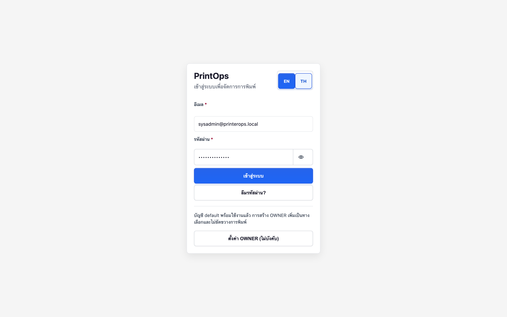

**ขั้นตอนการปฏิบัติงาน:**
1. **เลือกภาษาที่ต้องการ:** คลิกปุ่ม **`TH`** (ภาษาไทย) หรือ **`EN`** (ภาษาอังกฤษ) ที่มุมขวาบนของกล่องเข้าสู่ระบบ
2. **กรอกบัญชีผู้ใช้งาน:**
   - ใส่อีเมลผู้ใช้งานในช่อง **อีเมล** และรหัสผ่านในช่อง **รหัสผ่าน** (สามารถคลิกไอคอนรูปดวงตาเพื่อดูรหัสผ่านที่พิมพ์ได้)
   - กดปุ่ม **เข้าสู่ระบบ** (สีน้ำเงิน)
3. **กรณีเปิดใช้งานครั้งแรกหรือต้องการเพิ่มบัญชีผู้ดูแลระบบสูงสุด (Owner):**
   - คลิกที่ลิงก์ **ตั้งค่าเจ้าของเพิ่มเติม** ด้านล่างเพื่อสร้างบัญชีระดับ `OWNER` พร้อมรับ **รหัสกู้คืน (Recovery Code)** สำหรับใช้รีเซ็ตรหัสผ่านในอนาคต
4. **กรณีลืมรหัสผ่าน:** คลิก **ลืมรหัสผ่าน?** แล้วกรอกอีเมลพร้อมรหัสกู้คืนแบบใช้ครั้งเดียว (Single-use Recovery Code) เพื่อกำหนดรหัสผ่านใหม่ทันที

---

### 2.2 การอ่านค่าหน้าแดชบอร์ด (Dashboard) และแถบงานด่วน

หลังจากเข้าสู่ระบบ จะพบกับหน้า **แดชบอร์ด (Dashboard)** ซึ่งเป็นศูนย์รวมสถานะภาพรวมของสถานีพิมพ์

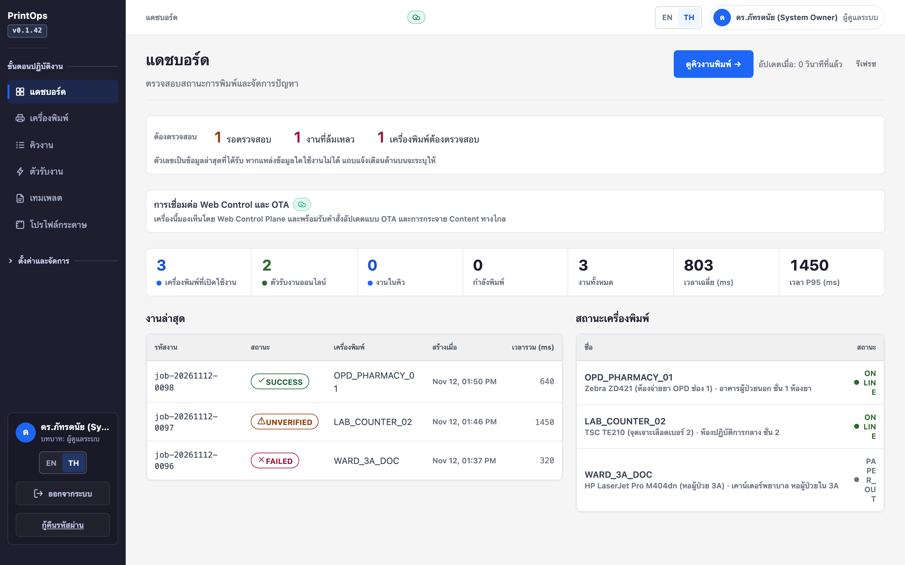

**จุดสำคัญที่ผู้ใช้งานต้องสังเกต:**
1. **แถบ "ต้องตรวจสอบ" (Attention Strip ด้านบนสุด):**
   - สรุปจำนวนงานหรืออุปกรณ์ที่ต้องการการดูแลทันที เช่น **`1 รอตรวจสอบ (UNVERIFIED)`**, **`1 งานที่ล้มเหลว (FAILED)`**, หรือ **`1 เครื่องพิมพ์ต้องตรวจสอบ`**
   - **วิธีใช้งาน:** คลิกที่ตัวเลขแจ้งเตือนแต่ละรายการ ระบบจะพาไปยังหน้าคิวงานหรือหน้าเครื่องพิมพ์ที่กรองเฉพาะรายการที่มีปัญหานั้นให้อัตโนมัติ
2. **แถบ "การเชื่อมต่อ Web Control และ OTA":**
   - ไอคอนรูปก้อนเมฆสีเขียวพร้อมเครื่องหมายถูก แสดงว่าเครื่องสถานีนี้เชื่อมต่อกับ **Web Control Plane** ส่วนกลางเรียบร้อยแล้ว และพร้อมรับคำสั่งอัปเดตหรือซิงก์เทมเพลตทางไกล
3. **ตารางสรุปตัวเลขและงานล่าสุด:**
   - แสดงจำนวนเครื่องพิมพ์ที่เปิดใช้งาน, ตัวรับงาน (Runners) ที่ออนไลน์, เวลาเฉลี่ยในการพิมพ์ (ms) พร้อมรายการงานล่าสุดและสถานะเครื่องพิมพ์ทุกตัวในหน้าเดียว

---

### 2.3 ขั้นตอนที่ 1: การค้นหาและลงทะเบียนเครื่องพิมพ์ (Discovery & Printers)

เพื่อให้ PrintOps สั่งพิมพ์ออกเครื่องพิมพ์ที่ต่ออยู่กับคอมพิวเตอร์ (USB / Windows Spooler) หรือเครื่องพิมพ์เครือข่ายได้ ต้องทำการลงทะเบียนเครื่องพิมพ์เข้าสู่ระบบก่อน

#### 2.3.1 การค้นหาเครื่องพิมพ์อัตโนมัติ (เมนู "ค้นหาเครื่องพิมพ์")
1. ที่แถบเมนูด้านซ้าย คลิกเปิดหมวด **ตั้งค่าและจัดการ** แล้วเลือกเมนู **ค้นหาเครื่องพิมพ์ (Discovery)**
2. ระบบ Go Runner ในเครื่องจะสแกนหาเครื่องพิมพ์ทั้งหมดที่ติดตั้งอยู่ใน Windows ของเครื่องนั้นมาแสดงในตาราง

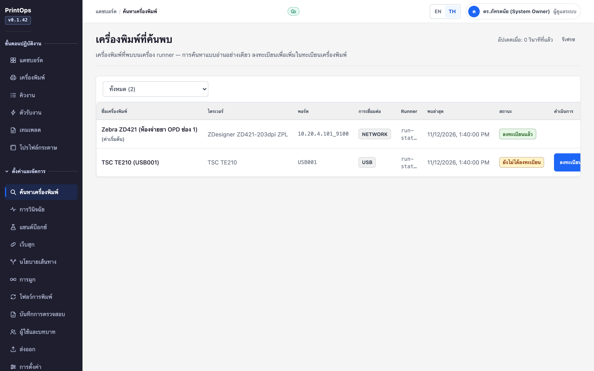

3. มองหาเครื่องพิมพ์ที่มีสถานะเป็นป้ายสีเหลือง **`ยังไม่ลงทะเบียน`** (เช่น `TSC TE210 (USB001)`)
4. คลิกปุ่ม **ลงทะเบียน** ด้านขวาสุดของแถวนั้น แล้วกดยืนยันในหน้าต่างป๊อปอัป เครื่องพิมพ์จะถูกเพิ่มเข้าสู่ทะเบียนพร้อมใช้งานทันที

#### 2.3.2 การตรวจสอบรายการเครื่องพิมพ์และทดสอบพิมพ์ (เมนู "เครื่องพิมพ์")
1. คลิกที่เมนู **เครื่องพิมพ์ (Printers)** ในหมวดขั้นตอนปฏิบัติงานด้านซ้าย
2. สามารถค้นหาเครื่องพิมพ์ด้วยรหัส/ชื่อ หรือกรองดูเฉพาะเครื่องที่มีปัญหาด้วยตัวกรอง **ความพร้อมของเครื่องพิมพ์**

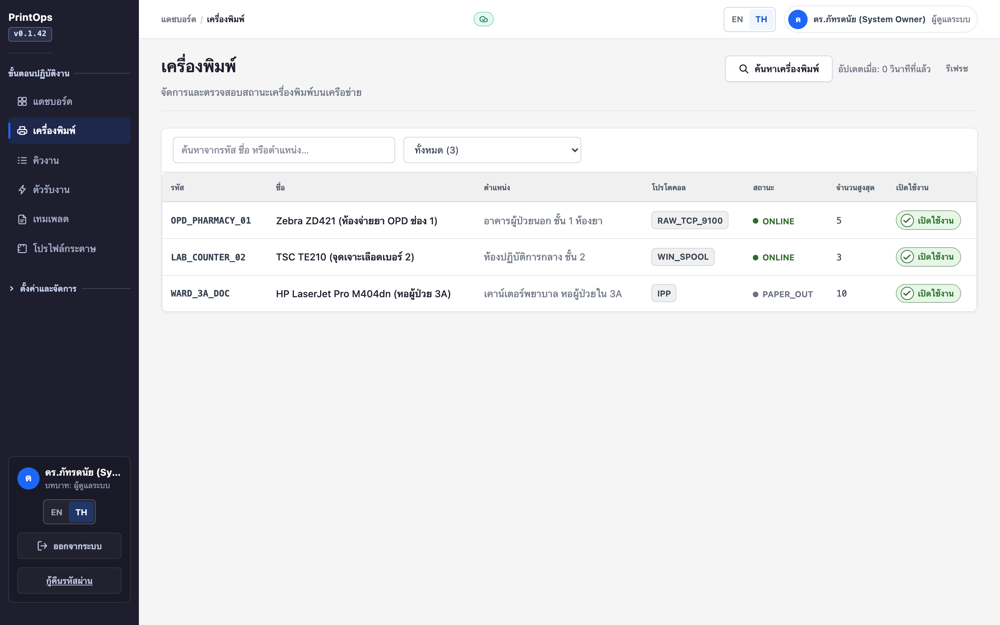

3. คลิกที่ **รหัสเครื่องพิมพ์** (เช่น `OPD_PHARMACY_01`) เพื่อเปิดดูหน้ารายละเอียดของเครื่องพิมพ์

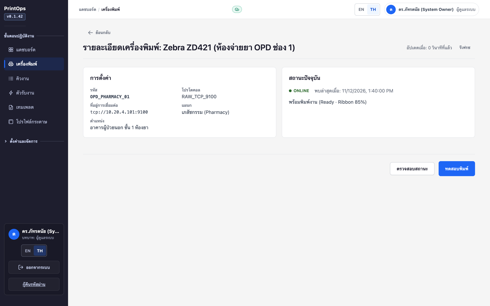

4. ในหน้ารายละเอียดเครื่องพิมพ์:
   - กดปุ่ม **ตรวจสอบสถานะ** เพื่อดึงสถานะล่าสุดจากตัวเครื่องพิมพ์จริง
   - กดปุ่ม **พิมพ์ทดสอบ (Test Print)** เพื่อส่งใบทดสอบออกไปยังเครื่องพิมพ์ เป็นการยืนยันว่าสายสัญญาณและไดรเวอร์พร้อมทำงาน 100% (หากเครื่องพิมพ์กระดาษหมดหรือออฟไลน์ ปุ่มพิมพ์ทดสอบจะถูกล็อกไว้เพื่อความปลอดภัย)

---

### 2.4 ขั้นตอนที่ 2: การออกแบบโปรไฟล์กระดาษและจัดวางฉลาก (Paper Profiles)

**โปรไฟล์กระดาษ (Paper Profile)** คือการกำหนดขนาดสติกเกอร์หรือกระดาษจริง (เช่น กว้าง 100 มม. × สูง 50 มม. ความละเอียด 203 DPI) พร้อมทั้งสามารถวางฟิลด์ข้อความ บาร์โค้ด และคิวอาร์โค้ดแบบลากวาง (Visual Canvas) ได้ทันที

#### 2.4.1 คลังโปรไฟล์กระดาษ
1. คลิกเมนู **โปรไฟล์กระดาษ (Paper Profiles)** ที่แถบซ้าย
2. หน้าจอจะแสดงรายการโปรไฟล์กระดาษทั้งหมด พร้อมขนาด (มม.), ความละเอียด (DPI), แนวกระดาษ และจำนวนฟิลด์

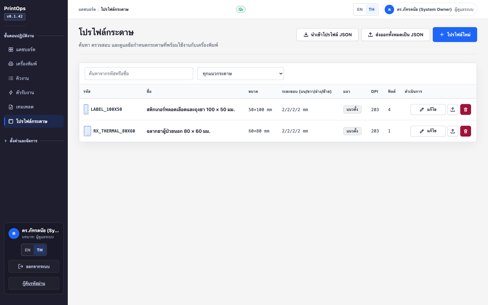

3. ปุ่มเครื่องมือด้านบนขวา:
   - **นำเข้าโปรไฟล์ JSON / ส่งออกโปรไฟล์ทั้งหมด:** สำหรับสำรองหรือย้ายการตั้งค่ากระดาษผ่านไฟล์ `.json`
   - **สร้างโปรไฟล์:** สำหรับสร้างขนาดกระดาษใหม่ตั้งแต่ต้น

#### 2.4.2 การใช้งานกระดานออกแบบฉลาก (Visual Label Designer)
เมื่อคลิกปุ่มแก้ไข (ไอคอนดินสอ) หรือกดสร้างโปรไฟล์ใหม่ จะเข้าสู่หน้า **แก้ไขโปรไฟล์กระดาษ**:

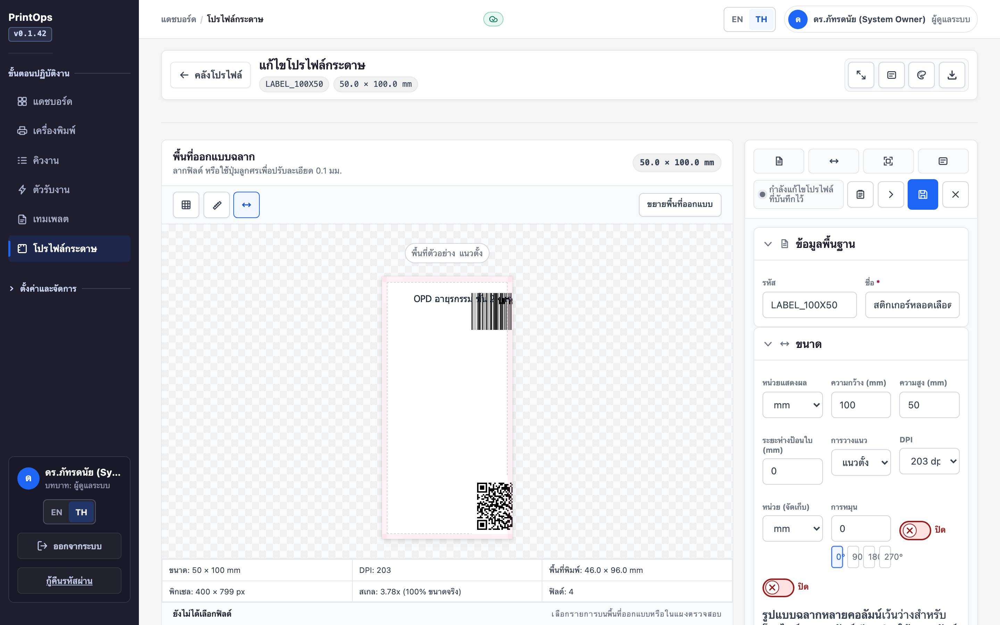

**ขั้นตอนการตั้งค่าและออกแบบทีละสเต็ป:**
1. **กำหนดข้อมูลพื้นฐานและขนาด (แผงด้านขวา):**
   - **รหัส (Code):** ตั้งรหัสอ้างอิงภาษาอังกฤษ เช่น `LABEL_100X50` หรือ `RX_THERMAL_80X60`
   - **ชื่อ:** ตั้งชื่อที่เข้าใจง่าย เช่น `สติกเกอร์หลอดเลือดและถุงยา 100 × 50 มม.`
   - **ความกว้าง / ความสูง (mm) และ DPI:** ระบุขนาดจริงของดวงสติกเกอร์และค่า DPI ของหัวพิมพ์ (เช่น `203 dpi` หรือ `300 dpi`) หรือคลิกเลือกจากปุ่ม **Preset** มาตรฐาน
2. **การเพิ่มและจัดวางฟิลด์บนกระดาน (พื้นที่ออกแบบด้านซ้าย):**
   - คลิกไอคอน **จัดการฟิลด์** ที่แถบเครื่องมือขวาบนเพื่อเพิ่มฟิลด์ชนิดต่างๆ ได้แก่:
     - `text` / `number` / `date`: ข้อความทั่วไป ตัวเลข หรือวันที่
     - `barcode`: บาร์โค้ด 1 มิติ (เช่น Code 128, EAN-13)
     - `qrcode`: คิวอาร์โค้ด 2 มิติ พร้อมระยะขอบปลอดภัย (Quiet Zone) อัตโนมัติ
   - **การขยับตำแหน่ง:** ใช้เมาส์ลากฟิลด์บนพื้นที่จำลองสติกเกอร์ได้เลย หรือกดปุ่มลูกศรบนคีย์บอร์ดเพื่อขยับละเอียดทีละ `0.1 มม.`
   - **ระบบตรวจสอบขอบเขตอัตโนมัติ:** แถบด้านล่างจะคำนวณพื้นที่พิมพ์จริง (Printable Area) และแจ้งเตือนทันทีหากบาร์โค้ดหรือคิวอาร์โค้ดล้นออกนอกขอบกระดาษ (เพราะหากถูกตัดขอบจะสแกนไม่ติด)
3. **การนำเข้าภาพต้นแบบ (Artwork Import):**
   - สามารถคลิกไอคอนนำเข้าดีไซน์ (มุมขวาบน) เพื่ออัปโหลดรูปภาพฉลากตัวอย่างมาเป็นพื้นหลังสำหรับทาบตำแหน่งฟิลด์ให้ตรงกับแบบฟอร์มของโรงพยาบาลหรือองค์กรได้
4. เมื่อปรับแต่งเสร็จสิ้น ให้คลิกปุ่ม **บันทึก (ไอคอนแผ่นดิสก์สีน้ำเงิน)** ที่แผงด้านขวา

---

### 2.5 ขั้นตอนที่ 3: การสร้างและเผยแพร่เทมเพลต (Templates)

หลังจากมีโปรไฟล์กระดาษแล้ว ขั้นตอนถัดไปคือการเตรียม **เทมเพลต (Template)** ซึ่งกำหนดรูปแบบคำสั่งพิมพ์และตัวแปรข้อมูล (`{{variable}}`) ที่จะรับมาจากระบบภายนอก

1. คลิกเมนู **เทมเพลต (Templates)** ที่แถบซ้ายเพื่อดูรายการเทมเพลตทั้งหมด

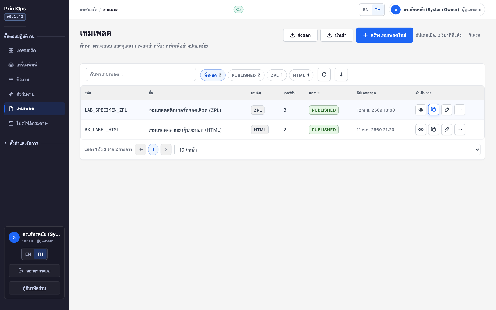

2. คลิกปุ่ม **สร้างเทมเพลตใหม่** หรือคลิกไอคอนแก้ไขที่เทมเพลตที่มีอยู่เพื่อเปิดหน้าแก้ไขแบบแยกสองฝั่ง (Split Workspace)

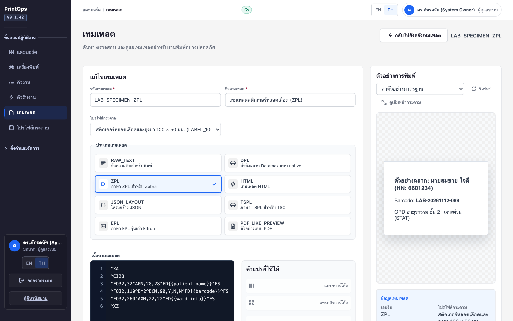

**ขั้นตอนการตั้งค่าเทมเพลต:**
1. **รหัสเทมเพลต (Template Code) และชื่อ:** ตั้งรหัส เช่น `LAB_SPECIMEN_ZPL` หรือ `RX_LABEL_HTML`
2. **โปรไฟล์กระดาษ:** เลือกโปรไฟล์กระดาษที่สร้างไว้ในขั้นตอนที่ 2 (เช่น `LABEL_100X50`)
3. **เลือกประเภทเทมเพลต (Engine):**
   - **`ZPL`:** ภาษาคำสั่งสำหรับเครื่องพิมพ์ตระกูล Zebra
   - **`TSPL`:** ภาษาคำสั่งสำหรับเครื่องพิมพ์ตระกูล TSC
   - **`DPL` / `EPL`:** ภาษาคำสั่งสำหรับ Datamax / Eltron
   - **`HTML`:** เทมเพลตภาษา HTML/CSS สำหรับพิมพ์ผ่านระบบ Windows Print Helper (รองรับฟอนต์ภาษาไทยและตารางซับซ้อนได้สมบูรณ์)
   - **`RAW_TEXT` / `JSON_LAYOUT`:** ข้อความดิบหรือโครงสร้าง JSON
4. **ใส่เนื้อหาเทมเพลตและตัวแปร:**
   - พิมพ์โค้ดเทมเพลตในกล่องสีเข้มด้านล่าง โดยใส่ชื่อตัวแปรในเครื่องหมายปีกกาคู่ เช่น `{{patient_name}}`, `{{barcode}}`, `{{ward_info}}`
   - สามารถคลิกปุ่มลัด **แทรกบาร์โค้ด** หรือ **แทรกคิวอาร์โค้ด** ด้านขวามือเพื่อวางโครงสร้างโค้ดอัตโนมัติ
5. **ตรวจสอบตัวอย่างด้านขวา (Live Preview) และเผยแพร่:**
   - แผงด้านขวาจะจำลองผลลัพธ์การพิมพ์ด้วยค่าตัวอย่างทันที (สามารถกด **ดูเต็มหน้ากระดาษ** เพื่อขยายใหญ่ได้)
   - กด **บันทึก** และเปลี่ยนสถานะเทมเพลตเป็น **`PUBLISHED` (เผยแพร่แล้ว)** เพื่อให้พร้อมใช้งานจริง

---

### 2.6 ขั้นตอนที่ 4: การผูกโฟลว์การพิมพ์อัตโนมัติ (Print Flow & Bindings)

เมื่อมีครบทั้ง **(1) เครื่องพิมพ์**, **(2) โปรไฟล์กระดาษ**, และ **(3) เทมเพลต** แล้ว เราจะนำทั้ง 3 ส่วนมาผูกเข้าด้วยกันในเมนู **โฟลว์การพิมพ์ (Print Flow)** เพื่อให้เมื่อโปรแกรมภายนอกยิง API เข้ามาที่รหัสเทมเพลตและโปรไฟล์กระดาษ ระบบจะรู้ทันทีว่าต้องส่งงานไปออกที่เครื่องพิมพ์ตัวใด

1. เปิดหมวด **ตั้งค่าและจัดการ** ที่แถบซ้าย แล้วคลิกเมนู **โฟลว์การพิมพ์ (Print Flow)** (หรือเมนู **การผูก / Bindings**)

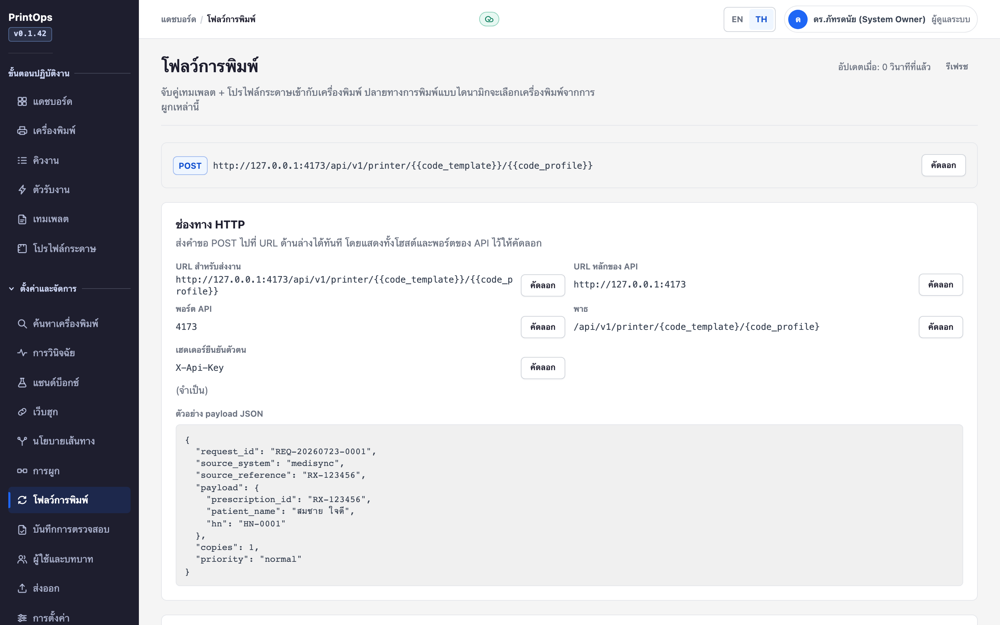

**สิ่งที่คุณทำได้ในหน้านี้:**
1. **คัดลอก URL และ Payload ตัวอย่างไปให้ทีมพัฒนา (Developer / Integrator):**
   - ระบบแสดง URL สำหรับยิงคำสั่งพิมพ์แบบไดนามิก:
     ```http
     POST http://<IP-ของเครื่อง>:31415/api/v1/printer/{code_template}/{code_profile}
     ```
   - มีปุ่ม **คัดลอก** ทั้ง URL, พอร์ต, เฮดเดอร์ยืนยันตัวตน (`X-Api-Key`), การตั้งค่า NATS JetStream Subject และตัวอย่าง JSON Payload ที่พร้อมนำไปทดสอบได้ทันที
2. **สร้างการผูกเครื่องพิมพ์ (Create Binding):**
   - เลือก **เทมเพลต** + **โปรไฟล์กระดาษ** + **เครื่องพิมพ์ปลายทาง** แล้วกดผูกเข้าด้วยกัน
3. **ตรวจสอบบันทึกการรับงาน (Intake Log):**
   - ตารางด้านล่างสุดจะแสดงประวัติทุกคำขอที่วิ่งเข้ามาว่าถูกรับงาน (`accepted`), ป้องกันงานซ้ำ (`duplicate`), หรือถูกปฏิเสธ (`rejected`) เพราะเหตุใด

---

### 2.7 ขั้นตอนที่ 5: การจำลองและทดสอบพิมพ์ด้วยแซนด์บ็อกซ์ (Template Sandbox)

ก่อนเปิดใช้งานจริงในคลินิกหรือสายการผลิต ผู้ดูแลระบบสามารถใช้เมนู **แซนด์บ็อกซ์ (Sandbox)** เพื่อจำลองข้อมูล JSON และทดลองสั่งพิมพ์ออกเครื่องพิมพ์จริงได้ครบทุกขั้นตอน

1. คลิกเมนู **แซนด์บ็อกซ์ (Sandbox)** ในหมวดตั้งค่าและจัดการ

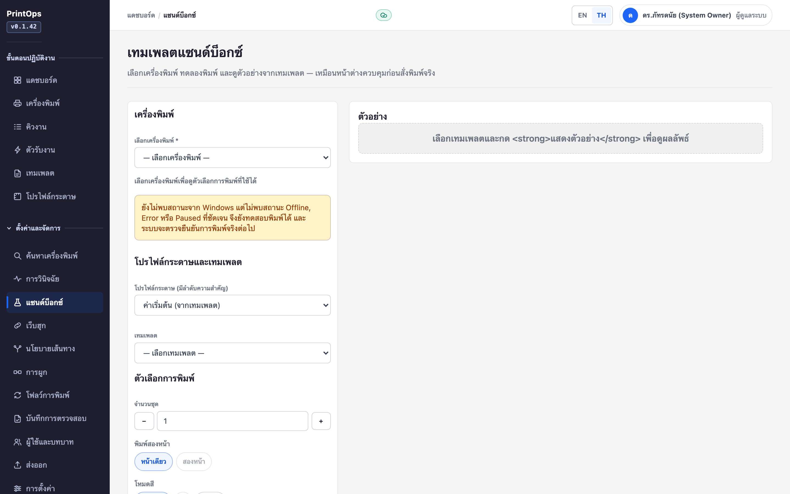

**ขั้นตอนการทดสอบ:**
1. เลือก **โปรไฟล์กระดาษ**, **เทมเพลต**, และ **เครื่องพิมพ์** ที่ต้องการทดสอบจากดรอปดาวน์ด้านซ้าย
2. กำหนดจำนวนสำเนา (Copies) และลำดับความสำคัญ (Priority)
3. (ทางเลือก) คลิกปุ่ม **แสดง (Show)** ในหัวข้อ *Expert payload* หากต้องการแก้ไขข้อมูล JSON ทดสอบด้วยตนเอง
4. คลิกปุ่ม **แสดงตัวอย่าง (Preview)** เพื่อดูภาพฉลากจำลองและโค้ดคำสั่งพิมพ์ที่จะถูกส่งไป
5. คลิกปุ่ม **พิมพ์ทดสอบจริง (Print)** เพื่อส่งงานเข้าคิวพิมพ์จริงและติดตามผลลัพธ์จนจบกระบวนการ

---

### 2.8 การตรวจสอบคิวงาน (Job Queue) และการสั่งพิมพ์ซ้ำอย่างปลอดภัย

สำหรับเจ้าหน้าที่หน้างาน (Operator) เมนูที่ใช้บ่อยที่สุดในแต่ละวันคือ **คิวงาน (Job Queue)** เพื่อติดตามงานพิมพ์และแก้ปัญหากรณีกระดาษติดหรือหมึกหมด

#### 2.8.1 หน้าคิวงาน (Job Queue)
1. คลิกเมนู **คิวงาน (Job Queue)** ที่แถบด้านซ้าย

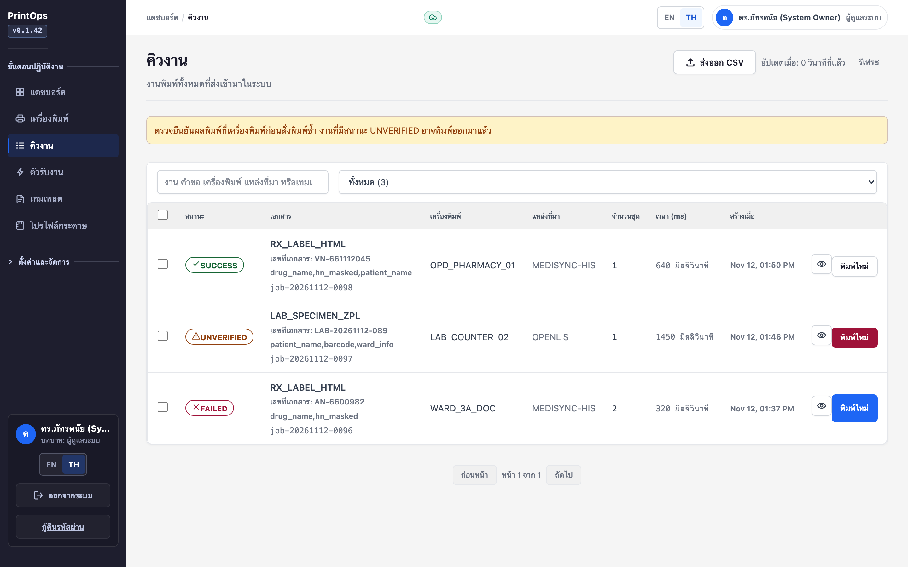

2. **การค้นหาและกรองงาน:**
   - พิมพ์ค้นหาด้วยรหัสงาน, เลขที่เอกสารอ้างอิง (เช่น HN, VN, เลขใบสั่งยา), หรือชื่อเครื่องพิมพ์ได้ทันที
   - ใช้ตัวกรองสถานะเพื่อเลือกดูเฉพาะงานที่ **`ต้องตรวจสอบ (Needs Attention)`**, **`UNVERIFIED`**, หรือ **`FAILED`**
3. **การดูสรุปด่วนและสั่งพิมพ์ใหม่ (Reprint):**
   - คลิกไอคอนรูปดวงตา (`👁`) ท้ายแถวเพื่อเปิดแถบสรุปข้อมูลด้านข้าง หรือคลิกที่รหัสงานเพื่อเปิดหน้ารายละเอียดเต็ม
   - คลิกปุ่ม **พิมพ์ใหม่ (Reprint)** ระบบจะแสดงหน้าต่างให้ระบุ **เหตุผลในการพิมพ์ซ้ำ** และสำหรับงานสถานะ `UNVERIFIED` หรือ `SUCCESS` ระบบจะมีช่องให้ติ๊กยืนยันว่า **"ตรวจสอบที่เครื่องพิมพ์แล้วว่ายังไม่มีฉลากออกมา (ป้องกันฉลากซ้ำ)"** ก่อนจึงจะกดยืนยันได้

#### 2.8.2 หน้ารายละเอียดงานและหลักฐานจากเครื่องพิมพ์ (Job Detail & Hardware Evidence)
เมื่อคลิกเข้ามาในงานแต่ละชิ้น จะเห็นข้อมูลเชิงลึกครบทุกมิติ:

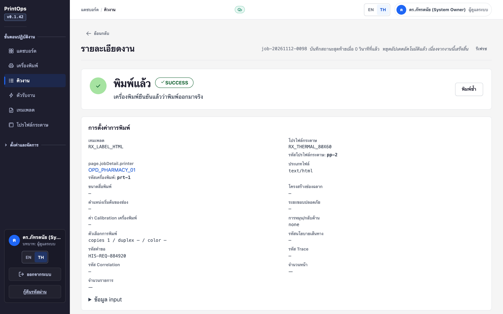

- **แถบตัดสินผลลัพธ์ (Verdict Band):** แสดงสถานะชัดเจน เช่น **"พิมพ์แล้ว (SUCCESS) — เครื่องพิมพ์ยืนยันแล้วว่าพิมพ์ออกมาจริง"**
- **การตั้งค่าการพิมพ์ (Print Configuration):** แสดงเทมเพลต, โปรไฟล์กระดาษ, เครื่องพิมพ์ และข้อมูล Input Payload
- **หลักฐานจากเครื่องพิมพ์ (Printer Evidence) และ Timeline Trace:** แสดงหมายเลขงานใน Windows Spooler, เลขหน้ากระดาษก่อนและหลังพิมพ์ (`pagesBefore -> pagesAfter`), ระยะเวลาที่ใช้ในแต่ละขั้นตอนย่อย (มิลลิวินาที) และสถานะการส่งแจ้งเตือนกลับ (Result Callback Delivery)

---

### 2.9 การตั้งค่าเชื่อมต่อระบบภายนอก (Webhooks, NATS & API Keys)

#### 2.9.1 การจัดการเว็บฮุกและการแจ้งผลกลับ (เมนู "เว็บฮุก / Webhooks")
1. คลิกเมนู **เว็บฮุก (Webhooks)** ในหมวดตั้งค่าและจัดการ

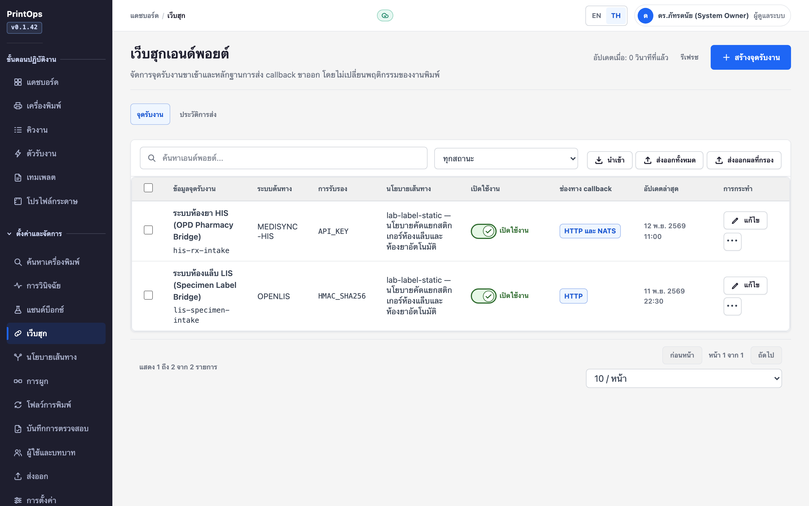

2. ในแท็บ **จุดเชื่อมต่อ (Endpoints):**
   - กดปุ่ม **สร้างจุดเชื่อมต่อ** เพื่อตั้งค่าการรับงานและตั้งค่า **Callback** ส่งผลลัพธ์เมื่อพิมพ์เสร็จกลับไปยังระบบต้นทาง (รองรับทั้ง `HTTP POST` พร้อมลายเซ็น `HMAC-SHA256` และ `NATS Subject`)
   - สามารถกดเมนูสามจุดท้ายแถวเพื่อเลือก **ทดสอบส่ง Callback** ไปยังเซิร์ฟเวอร์ปลายทางได้ทันที
3. ในแท็บ **ประวัติการส่ง (Delivery History):**
   - ตรวจสอบหลักฐานการแจ้งผลกลับทุกครั้ง (HTTP Status Code, เวลาที่ใช้, หรือข้อความ Error กรณีปลายทางล่ม)

#### 2.9.2 การตรวจความพร้อมของระบบ การสำรองฐานข้อมูล และการสร้าง API Key (เมนู "การตั้งค่า / Settings")
1. คลิกเมนู **การตั้งค่า (Settings)** ล่างสุดของแถบเมนูซ้าย

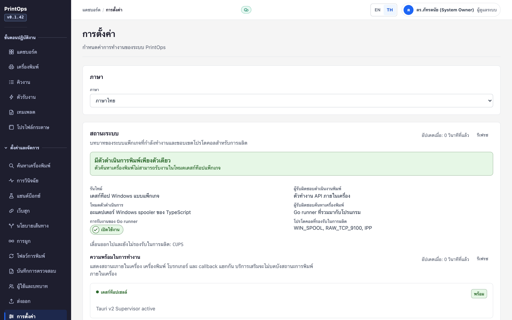

2. **ส่วนความพร้อมในการทำงาน (System Readiness):**
   - แสดงไฟสถานะแยกตามส่วนประกอบย่อย ได้แก่ `เดสก์ท็อปเชลล์ (Tauri)`, `บริการ API ภายในเครื่อง`, `ฐานข้อมูล SQLite`, `ตัวรับงานพิมพ์ภายในเครื่อง`, `ตัวค้นหาเครื่องพิมพ์ (Go Runner)` และ `NATS`
   - มีปุ่ม **สำรองฐานข้อมูล (Database Backup)** สำหรับดาวน์โหลดไฟล์ `.db` และปุ่ม **ดาวน์โหลดชุดข้อมูลวิเคราะห์ปัญหา (Support Bundle)** สำหรับส่งให้ทีมวิศวกรตรวจสอบเมื่อเกิดปัญหา
3. เมื่อเลื่อนลงมาด้านล่างของหน้าการตั้งค่า จะพบกับส่วน **รับงานพิมพ์ผ่าน NATS**, **การเชื่อมต่อ Web Control**, และ **คีย์ API สำหรับระบบเชื่อมต่อ (Service Accounts)**:

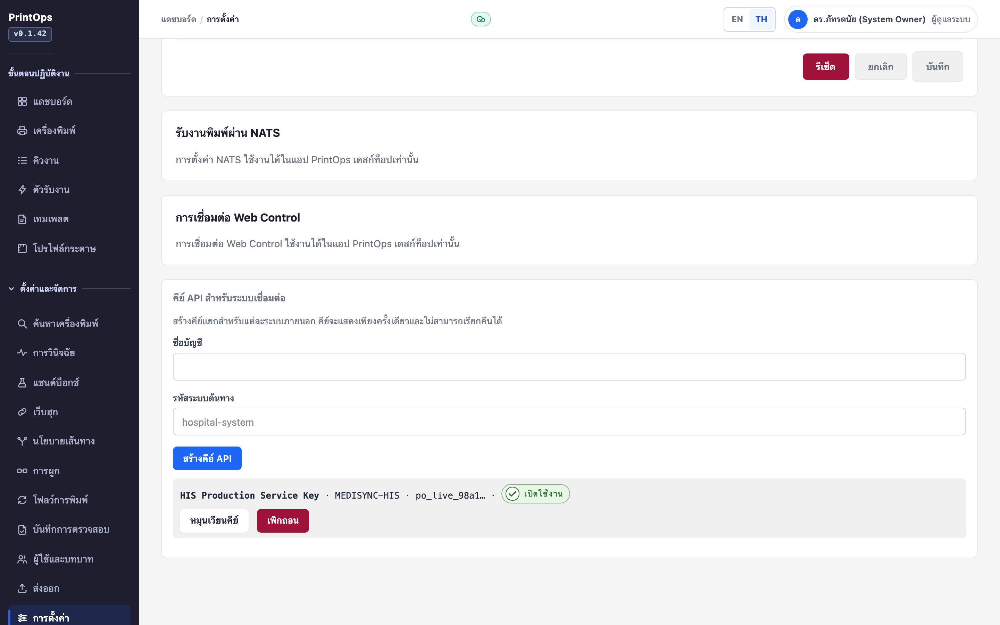

   - ในหัวข้อ **คีย์ API สำหรับระบบเชื่อมต่อ:** ผู้ดูแลระบบ (`OWNER`) สามารถกรอกชื่อบัญชีและรหัสระบบต้นทาง (เช่น `MEDISYNC-HIS`) แล้วกด **สร้างคีย์ API** เพื่อออกรหัสกุญแจ `po_live_...` นำไปใส่ในเฮดเดอร์ `X-Api-Key` ของโปรแกรมที่ส่งงานพิมพ์เข้ามา รวมถึงสามารถกด **หมุนเวียนคีย์ (Rotate)** หรือ **เพิกถอน (Revoke)** ได้ตลอดเวลา

---

### 2.10 การจัดการผู้ใช้งานและสิทธิ์การเข้าถึง (Users & Roles)

1. คลิกเมนู **ผู้ใช้และบทบาท (Users & Roles)** ในหมวดตั้งค่าและจัดการ

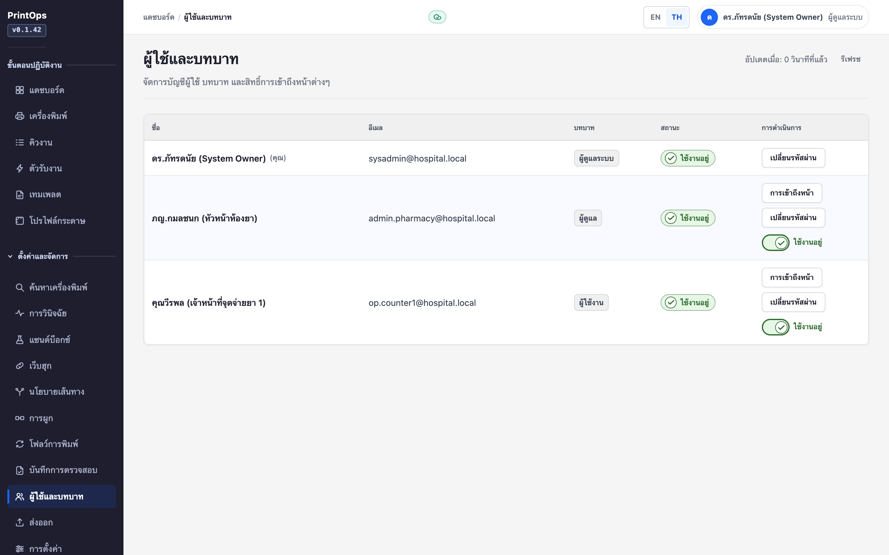

2. ระบบแบ่งระดับสิทธิ์ออกเป็น 4 บทบาทมาตรฐาน:
   - **`OWNER` (เจ้าของระบบ):** มีสิทธิ์สูงสุดในทุกหน้า รวมถึงการจัดการโฟลว์การพิมพ์ แซนด์บ็อกซ์ และการออกคีย์ API
   - **`ADMIN` (ผู้ดูแลระบบ):** จัดการเครื่องพิมพ์ เทมเพลต โปรไฟล์กระดาษ เว็บฮุก และดูประวัติการตรวจสอบได้
   - **`OPERATOR` (เจ้าหน้าที่ปฏิบัติงาน):** ใช้งานแดชบอร์ด ดูคิวงาน สั่งพิมพ์ซ้ำ และตรวจสอบสถานะเครื่องพิมพ์ประจำวัน
   - **`VIEWER` (ผู้ตรวจสอบ):** ดูข้อมูลสถานะและคิวงานได้อย่างเดียว ไม่สามารถแก้ไขค่าหรือสั่งพิมพ์ซ้ำได้
3. นอกจากนี้ยังสามารถคลิกปุ่ม **สิทธิ์การเข้าถึงหน้า (Page Access)** ในแต่ละบัญชี เพื่อกำหนดรายชื่อเมนูที่อนุญาตให้เห็นรายบุคคลได้อย่างยืดหยุ่น

---

<div id="part-3"></div>

## บทที่ 3: คู่มือการใช้งานระบบควบคุมส่วนกลาง (Web Control Plane)

เมื่อองค์กรหรือโรงพยาบาลมีสถานีพิมพ์ PrintOps หลายจุด (เช่น 20–200 เครื่องทั่วโรงพยาบาล) การเดินไปตั้งค่าทีละเครื่องจะใช้เวลามาก **Web Control Plane** จึงทำหน้าที่เป็นศูนย์บัญชาการกลางสำหรับดูแลสถานีพิมพ์ทั้งหมดผ่านเว็บเบราว์เซอร์

---

### 3.1 การเข้าสู่ระบบ Web Control Plane

1. เปิดเว็บเบราว์เซอร์ไปยัง URL ของเซิร์ฟเวอร์ Web Control Plane ขององค์กร (เช่น `https://printops-control.hospital.local` หรือ `http://<Server-IP>:8080`)
2. กรอกอีเมลและรหัสผ่านของผู้ดูแลระบบส่วนกลาง แล้วคลิก **เข้าสู่ระบบ** *(หมายเหตุ: บัญชีผู้ใช้ของ Web Control Plane แยกอิสระจากบัญชีภายในเครื่องลูกข่ายแต่ละสถานี)*

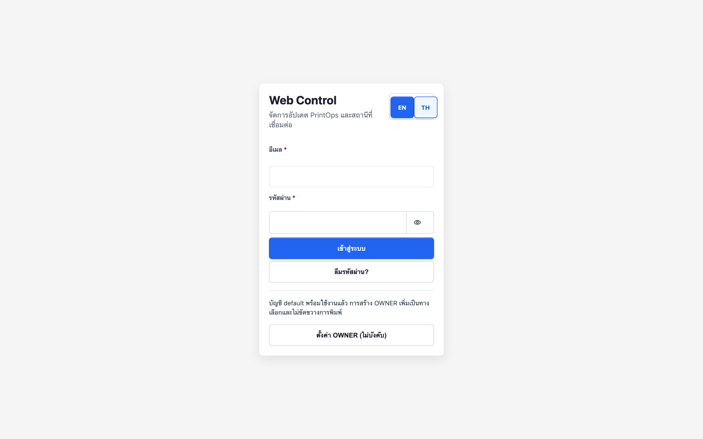

---

### 3.2 ขั้นตอนการเชื่อมโยงสถานีพิมพ์เข้ากับส่วนกลาง (Station Enrollment Workflow)

การนำเครื่องคอมพิวเตอร์ที่ติดตั้ง PrintOps Station App มาขึ้นทะเบียนกับ Web Control Plane ทำได้ง่ายและปลอดภัยด้วย **โทเคนลงทะเบียนแบบใช้ครั้งเดียว (One-Time Enrollment Token)** โดยไม่ต้องตั้งค่า Environment Variable ใดๆ บนเครื่องลูกข่าย:

#### ขั้นตอนที่ 1: สร้างโทเคนลงทะเบียนบน Web Control Plane
1. ในระบบ **Web Control** ให้คลิกเมนู **อุปกรณ์ (Devices)** ที่แถบด้านซ้าย

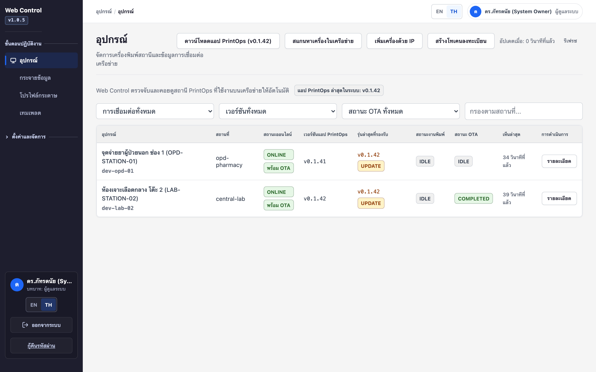

2. คลิกปุ่ม **สร้างโทเคนลงทะเบียน (Generate enrollment token)** ที่มุมขวาบน
3. กรอกรหัสสถานที่/แผนก (Site Identifier เช่น `opd-pharmacy` หรือ `central-lab`) และระยะเวลาหมดอายุ จากนั้นกดสร้างโทเคน

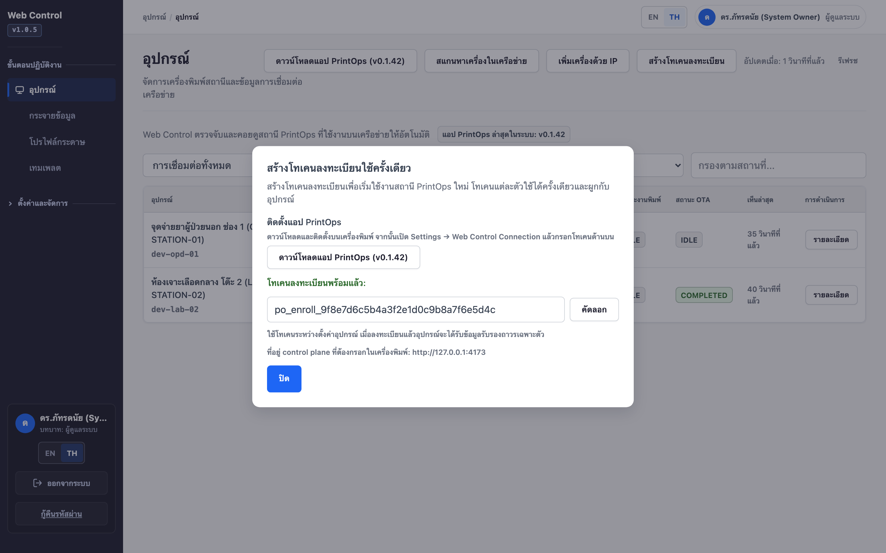

4. หน้าต่างป๊อปอัปจะแสดงข้อมูลสำคัญ 3 ส่วน:
   - **ปุ่มดาวน์โหลดแอป PrintOps (`.exe`):** หากเครื่องปลายทางยังไม่ได้ติดตั้งโปรแกรม สามารถดาวน์โหลดตัวติดตั้งเวอร์ชันล่าสุดจากปุ่มนี้ไปติดตั้งได้ทันที
   - **โทเคนลงทะเบียน (`po_enroll_...`):** คลิกปุ่ม **คัดลอก** เพื่อนำโทเคนนี้ไปใช้ที่เครื่องสถานีพิมพ์
   - **ที่อยู่ Control Plane:** URL ที่ต้องนำไปกรอกในเครื่องสถานีพิมพ์

#### ขั้นตอนที่ 2: กรอกโทเคนในแอป PrintOps บนเครื่องสถานีพิมพ์
1. เปิดโปรแกรม **PrintOps** บนเครื่องคอมพิวเตอร์หน้างาน แล้วไปที่เมนู **การตั้งค่า (Settings)** → เลื่อนลงมาที่หัวข้อ **การเชื่อมต่อ Web Control**
2. วาง **ที่อยู่ Control Plane** และ **โทเคนลงทะเบียน** ที่คัดลอกมา แล้วกดปุ่ม **เชื่อมต่อ (Connect)**
3. แอป PrintOps บนเครื่องสถานีจะแลกเปลี่ยนโทเคนเป็นข้อมูลรับรองประจำเครื่องถาวร (Per-device Credentials), บันทึกค่า NATS Broker URL อัตโนมัติ, และรีสตาร์ทบริการภายในเครื่องประมาณ 5–15 วินาที
4. เมื่อเชื่อมต่อสำเร็จ ไอคอนรูปก้อนเมฆด้านบนของแอปจะเปลี่ยนเป็นสีเขียว และชื่อเครื่องจะปรากฏขึ้นเป็น **`ONLINE`** บนหน้าจอ Web Control ทันที!

> **ทิปเพิ่มเติม:** หากเครื่องสถานีพิมพ์รันอยู่ในวงแลนเดียวกัน ผู้ดูแลระบบยังสามารถกดปุ่ม **สแกนหาเครื่องในเครือข่าย (Scan Network)** หรือ **เพิ่มเครื่องด้วย IP (Add by IP)** บนหน้าอุปกรณ์ของ Web Control เพื่อค้นหาสถานีพิมพ์ที่เปิดพอร์ต `31415` ได้อีกด้วย

---

### 3.3 การบริหารจัดการคลังเวอร์ชันและพื้นที่จัดเก็บไฟล์ (Releases Catalog & Storage)

ก่อนที่จะสั่งอัปเดตโปรแกรม PrintOps ให้เครื่องลูกข่ายผ่านระบบ OTA ผู้ดูแลระบบสามารถอัปโหลดไฟล์ตัวติดตั้งเก็บไว้ในคลังส่วนกลางได้ที่เมนู **เวอร์ชันอัปเดต (Releases)**

1. คลิกเปิดหมวด **ตั้งค่าและจัดการ** ที่แถบด้านซ้ายของ Web Control แล้วคลิกเมนู **เวอร์ชันอัปเดต (Releases)**

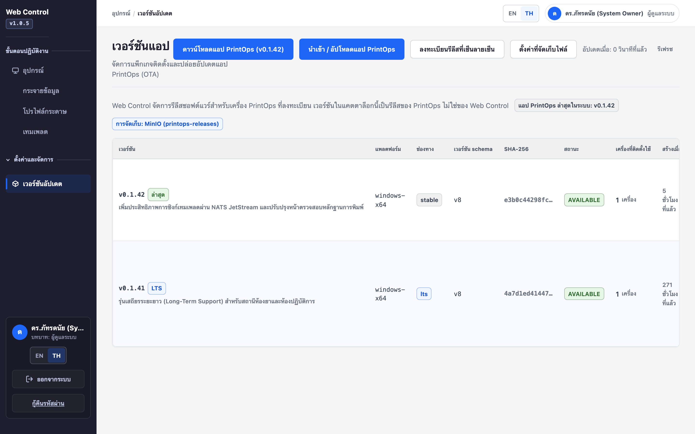

**ขั้นตอนการใช้งานในหน้าเวอร์ชันอัปเดต:**
1. **การตั้งค่าที่จัดเก็บไฟล์ (Storage Settings):**
   - คลิกปุ่ม **ตั้งค่าที่จัดเก็บไฟล์** ด้านบนขวา

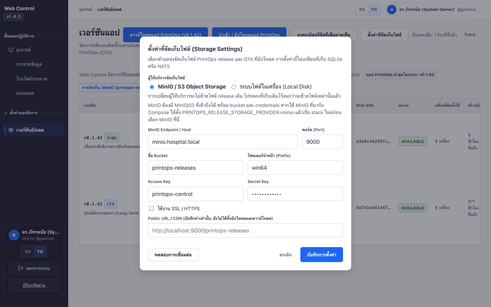

   - เลือกผู้ให้บริการจัดเก็บไฟล์ระหว่าง **ระบบไฟล์ในเครื่อง (Local Disk)** (ค่าเริ่มต้นเก็บที่ `/data/releases` ใน Docker Volume) หรือ **MinIO / S3 Object Storage**
   - กดปุ่ม **ทดสอบการเชื่อมต่อ** เพื่อยืนยันความพร้อม แล้วกด **บันทึกการตั้งค่า**
2. **การนำเข้า / อัปโหลดแอป PrintOps เวอร์ชันใหม่:**
   - คลิกปุ่มสีน้ำเงิน **นำเข้า / อัปโหลดแอป PrintOps**
   - เลือกไฟล์ตัวติดตั้ง `.exe` (เช่น `PrintOps_Setup_v0.1.42_windows-x64.exe`) ระบบจะอ่านเลขเวอร์ชัน คำนวณค่าแฮช `SHA-256` และสร้างข้อมูล Manifest สำหรับ OTA ให้อัตโนมัติโดยไม่ต้องเซ็นไฟล์ด้วยมือ
   - เลือกช่องทาง (`stable` หรือ `lts`) และติ๊ก **ตั้งเป็นรุ่นล่าสุด (Set as LATEST)** แล้วกดนำเข้า
3. **การจัดการสถานะเวอร์ชัน:**
   - สามารถกำหนดให้เวอร์ชันใดเป็น **LATEST** (รุ่นแนะนำสำหรับอัปเดต) หรือ **LTS** (รุ่นเสถียรระยะยาว) รวมถึงสั่ง **เพิกถอน (Revoke)** ได้ทันทีหากพบบั๊กในเวอร์ชันนั้น (เมื่อเพิกถอนแล้ว เครื่องลูกข่ายจะไม่สามารถดาวน์โหลดหรืออัปเดตเป็นเวอร์ชันนั้นได้อีก)

---

### 3.4 การสั่งอัปเดตซอฟต์แวร์ทางไกลและการย้อนกลับ (Remote OTA Update & Rollback)

เมื่อมีเวอร์ชันใหม่ในคลังแล้ว ผู้ดูแลระบบสามารถสั่งอัปเดตเครื่องสถานีพิมพ์จากส่วนกลางได้โดยไม่ต้องรีโมตหน้าจอไปติดตั้งเอง

1. ไปที่เมนู **อุปกรณ์ (Devices)** จะเห็นป้ายแจ้งเตือนสีเหลือง **`UPDATE`** ในคอลัมน์ *รุ่นล่าสุดที่รองรับ* ของเครื่องที่เป็นเวอร์ชันเก่า
2. คลิกปุ่ม **รายละเอียด (Detail)** ท้ายแถวของเครื่องสถานีนั้น

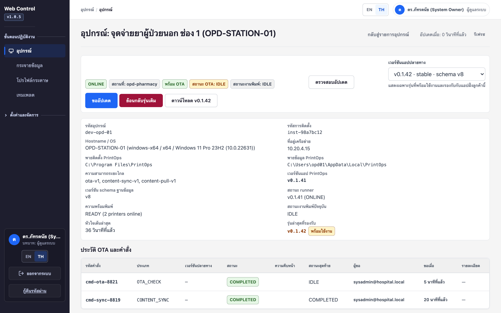

**ขั้นตอนการสั่งอัปเดตและดูแลรักษาทางไกล:**
1. **ตรวจสอบความพร้อมก่อนอัปเดต:**
   - ดูป้ายสถานะด้านบนว่าเครื่องเป็น **`ONLINE`**, **`พร้อม OTA`**, และดู `สถานะงานพิมพ์` ปัจจุบัน
2. **สั่งอัปเดตเวอร์ชัน (Request Update):**
   - เลือกเวอร์ชันปลายทางในช่อง **เวอร์ชันแอปปลายทาง** (ระบบจะกรองเฉพาะเวอร์ชันที่เข้ากันได้กับ Schema ฐานข้อมูลของเครื่องลูกข่ายนั้น)
   - คลิกปุ่มสีน้ำเงิน **ขออัปเดต (Request update)** แล้วกดยืนยัน
   - **ระบบความปลอดภัยระหว่างอัปเดต (Print-Safe Breakaway OTA):** หากเครื่องหน้างานกำลังพิมพ์ฉลากค้างอยู่ (`PRINTING`) ตัวอัปเดตจะรอจนกว่างานพิมพ์จะเสร็จสิ้น (`WAITING_FOR_IDLE`) จากนั้นจึงสำรองฐานข้อมูล SQLite สลับไฟล์โปรแกรม และตรวจสอบสุขภาพระบบ (Health Check) อัตโนมัติ
3. **การย้อนกลับรุ่นเดิม (Rollback):**
   - หากอัปเดตแล้วพบปัญหาการใช้งาน สามารถคลิกปุ่มสีแดง **ย้อนกลับรุ่นเดิม (Rollback)** เพื่อสั่งให้สถานีพิมพ์ถอยกลับไปใช้ไบนารีและฐานข้อมูลรุ่นก่อนหน้าได้ทันที
4. **ตารางประวัติ OTA และคำสั่ง (OTA & Command History):**
   - ด้านล่างสุดจะแสดงสถานะความคืบหน้าแบบเรียลไทม์ของทุกคำสั่งที่ส่งไปยังเครื่องนั้น (`OTA_CHECK`, `OTA_INSTALL`, `OTA_ROLLBACK`, `CONTENT_SYNC`)

---

### 3.5 การกระจายและดึงกลับโปรไฟล์กระดาษและเทมเพลต (Content Distribution & Pull)

คุณสามารถออกแบบ **โปรไฟล์กระดาษ** และ **เทมเพลต** ต้นฉบับไว้บน Web Control Plane (ผ่านเมนู *โปรไฟล์กระดาษ* และ *เทมเพลต* บนแถบซ้ายของ Web Control ซึ่งมีหน้าตาเหมือนกับในแอปทุกประการ) หรือดึงเทมเพลตที่ตกแต่งเสร็จแล้วจากเครื่องลูกข่ายเครื่องหนึ่ง มาแจกจ่ายให้เครื่องอื่นๆ ทั่วทั้งโรงพยาบาลได้ในคลิกเดียว

1. คลิกเมนู **กระจายข้อมูล (Distribute Content)** ที่แถบด้านซ้ายของ Web Control

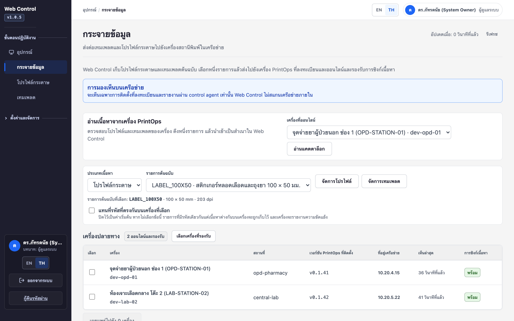

**รูปแบบการทำงานที่ 1: การดึงเทมเพลต/โปรไฟล์จากเครื่องลูกข่ายขึ้นมาเก็บที่ส่วนกลาง (Pull & Import from Client)**
1. ในกล่อง **อ่านเนื้อหาจากเครื่อง PrintOps** ด้านบน ให้เลือกเครื่องลูกข่ายที่ออนไลน์จากดรอปดาวน์
2. คลิกปุ่ม **อ่านแคตตาล็อก (Read catalog)** ระบบจะส่งคำสั่งไปอ่านรายชื่อโปรไฟล์กระดาษและเทมเพลตทั้งหมดในเครื่องนั้นมาแสดง
3. คลิกปุ่ม **ดึงมาตรวจสอบ (Pull for review)** ที่รายการที่ต้องการ แล้วกด **นำเข้าเป็นสำเนา (Import copy)** เพื่อบันทึกเก็บเข้าคลังต้นฉบับของ Web Control (หากนำเข้าเทมเพลต ระบบจะดึงโปรไฟล์กระดาษที่ผูกอยู่มาให้ด้วยอัตโนมัติ)

**รูปแบบการทำงานที่ 2: การส่งโปรไฟล์กระดาษหรือเทมเพลตจากส่วนกลางไปยังหลายสถานีพร้อมกัน (Push / Publish to Clients)**
1. เลือก **ประเภทเนื้อหา** (`โปรไฟล์กระดาษ` หรือ `เทมเพลต`) และเลือก **รายการต้นฉบับ** ที่ต้องการแจกจ่าย
2. หากต้องการให้เขียนทับรายการที่มีรหัส (`Code`) เดิมบนเครื่องปลายทาง ให้ติ๊กถูกที่ช่อง **แทนที่รหัสที่ตรงกันบนเครื่องที่เลือก** (หากไม่ติ๊กและเครื่องปลายทางมีรหัสซ้ำที่เนื้อหาต่างกัน เครื่องปลายทางจะปฏิเสธการทับและรายงานความขัดแย้งให้ทราบอย่างปลอดภัย)
3. ในตาราง **เครื่องปลายทาง** ด้านล่าง คลิกปุ่ม **เลือกเครื่องที่รองรับ** (หรือติ๊กเลือกเฉพาะเครื่องตามแผนกที่ต้องการ)
4. คลิกปุ่ม **เผยแพร่ไปยัง X เครื่อง (Publish)** ด้านล่างสุด แล้วดูแถบความคืบหน้าจนขึ้นสถานะ `COMPLETED` ครบทุกเครื่อง

---

<div id="part-4"></div>

## บทที่ 4: แนวทางการแก้ไขปัญหาเบื้องต้นและคำถามที่พบบ่อย (Troubleshooting & FAQ)

| อาการที่พบ | สาเหตุที่เป็นไปได้ | วิธีแก้ไขตามลำดับขั้นตอน |
| :--- | :--- | :--- |
| **1. งานพิมพ์ขึ้นสถานะ `UNVERIFIED` (สีส้ม)** | ระบบส่งคำสั่งไปที่พอร์ตหรือ Windows Spooler สำเร็จแล้ว แต่เครื่องพิมพ์เชื่อมต่อผ่านพอร์ต (เช่น USB บางรุ่น) ที่ไม่ส่งเลขหน้ากระดาษยืนยันกลับ | 1. **ตรวจดูที่เครื่องพิมพ์จริงก่อน** ว่าฉลากไหลออกมาหรือไม่<br>2. หากฉลากออกมาแล้ว **ไม่ต้องกดพิมพ์ซ้ำ**<br>3. หากฉลากไม่ออก (เช่น เปิดฝาเครื่องค้างไว้) ให้จัดกระดาษให้เรียบร้อย แล้วกดปุ่ม **พิมพ์ใหม่** ในหน้าคิวงานพร้อมติ๊กยืนยันความเสี่ยงพิมพ์ซ้ำ |
| **2. งานพิมพ์ขึ้นสถานะ `FAILED` หรือปุ่มพิมพ์ทดสอบกดไม่ได้** | เครื่องพิมพ์ออฟไลน์ ปิดสวิตช์ กระดาษหมด (`PAPER_OUT`) หรือตั้งค่า `Work Offline` ใน Windows | 1. เปิดเมนู **เครื่องพิมพ์** → คลิกเข้าหน้ารายละเอียดของเครื่องพิมพ์นั้น<br>2. อ่านข้อความแจ้งเตือนสีเหลือง/แดงด้านบน และดูสถานะจริง (`rawStatus` / `workOffline`)<br>3. ใส่กระดาษหรือเปิดเครื่องพิมพ์ แล้วกดปุ่ม **ตรวจสอบสถานะ** จนกว่าจะขึ้น `ONLINE` |
| **3. ยิง API เข้ามาแล้วได้ Error `404` หรือไม่พบเครื่องพิมพ์** | ยังไม่ได้ผูก `template_code` + `code_profile` เข้ากับ `printer_code` หรือเทมเพลตยังไม่ได้กด Publish | 1. ไปที่เมนู **เทมเพลต** ตรวจดูว่าสถานะเป็น `PUBLISHED` หรือยัง<br>2. ไปที่เมนู **โฟลว์การพิมพ์ (Print Flow)** ตรวจสอบว่ามีการผูกคู่เทมเพลตและโปรไฟล์กระดาษนั้นเข้ากับเครื่องพิมพ์ที่เปิดใช้งานอยู่แล้ว และดูตาราง Intake Log ด้านล่างสุดเพื่ออ่านสาเหตุที่ถูกปฏิเสธ |
| **4. บันทึกโปรไฟล์กระดาษไม่ได้ ระบบฟ้องว่าฟิลด์ล้นขอบ** | ตำแหน่งแกน `(X, Y)` หรือขนาดความกว้าง/สูงของบาร์โค้ดและคิวอาร์โค้ดเกินพื้นที่พิมพ์จริงหลังหักระยะขอบ (Margins) | 1. เปิดหน้าแก้ไข **โปรไฟล์กระดาษ**<br>2. สังเกตกรอบเส้นประสีชมพูบนกระดานออกแบบ (เขตพื้นที่ปลอดภัย)<br>3. ขยับบาร์โค้ด/คิวอาร์โค้ดเข้ามาด้านใน หรือลดขนาด `barcodeHeightMm` / `qrSizeMm` จนแถบแจ้งเตือนสีแดงหายไป |
| **5. เครื่องสถานีพิมพ์ไม่ขึ้น `ONLINE` บน Web Control Plane** | เครื่องลูกข่ายยังไม่ได้ลงทะเบียนโทเคน หรือไฟร์วอลล์บล็อกพอร์ต NATS (`4222`) ของเซิร์ฟเวอร์ Web Control | 1. บนเครื่องลูกข่าย เปิดเมนู **การตั้งค่า** → ดูหัวข้อ **การเชื่อมต่อ Web Control** ว่าลงทะเบียนหรือยัง<br>2. ตรวจสอบบนเซิร์ฟเวอร์ Web Control ว่าค่า `PRINTOPS_CONTROL_PUBLIC_NATS_URL` เป็น IP ที่เครื่องลูกข่ายมองเห็นได้ผ่านเครือข่าย LAN/VPN (ห้ามตั้งเป็น `localhost` หรือชื่อ Container ภายใน Docker) |
| **6. ปุ่ม "ขออัปเดต (OTA)" บน Web Control กดไม่ได้** | เครื่องลูกข่ายออฟไลน์, กำลังอยู่ในสถานะ `RECOVERY_REQUIRED`, หรือยังไม่มีแพ็กเกจเวอร์ชันใหม่ที่ตรงกับ `schemaVersion` | 1. ตรวจสอบในเมนู **เวอร์ชันอัปเดต (Releases)** ว่าอัปโหลดไฟล์ `.exe` ที่มีสถานะ `AVAILABLE` และมีเลขเวอร์ชันสูงกว่าเครื่องลูกข่ายแล้ว<br>2. หากเครื่องลูกข่ายขึ้น `RECOVERY_REQUIRED` ให้ตรวจสอบบริการที่เครื่องหน้างานก่อน |

---

*จัดทำโดยระบบเอกสารอัตโนมัติ PrintOps — สำหรับใช้อ้างอิงในการปฏิบัติงานและการฝึกอบรมผู้ใช้งาน*
